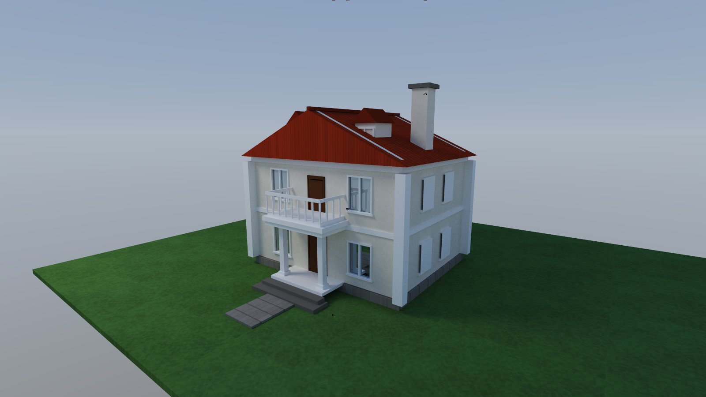
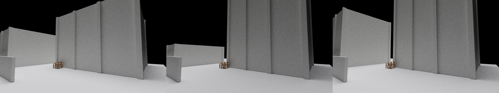

<p align="center">
  
</p>

<h1 align="center">Archbloom</h1>

<p align="center"><b>An agent-first 3D modeling workbench for architecture — one sentence in, a full set of deliverables out.</b></p>

<p align="center">
  
  
  
  
</p>

<p align="center"><a href="README.md">中文</a> · <b>English</b></p>

> **A note up front**: this is a personal attempt at wiring AI into 3D, and it is meant to be used on
> real modeling work. It is usable today, and it can also serve as a benchmark for how well large
> models handle 3D modeling and spatial reasoning. It is a small, imperfect piece of work — I would
> genuinely welcome criticism.

The agent drafts, you decide. Parametric massing and furnishings assemble a scene in one call;
stills, 8K panoramas, stereo VR panoramas and walkthrough videos come out in a single pass;
FBX / IFC / glTF round-trip in both directions; 30+ modeling and rendering tools are exposed to the
agent over MCP.

---

## One look says it all

<p align="center">
  
</p>

<p align="center"><i>A hand-assembled two-storey villa: pitched roof, dormers, chimney, colonnade, balustrade array, door and window openings, procedural textures, sky environment light — every piece generated from an op script, then path-traced at 512spp.</i></p>

<p align="center">
  
</p>

<p align="center"><i>One brief, N scheme variants, plus a side-by-side comparison sheet — the agent operates, the human reviews.</i></p>

## One-call delivery (minimal brief)

```json
{ "compose": {
    "template": "community_center",
    "name": "My Community Centre",
    "renderer": "auto",
    "deliverables": {
      "perspective": { "path": "out/view.png", "width": 1600, "height": 900 },
      "walkthrough": { "dir": "out/walk", "waypoints": [[2,26,2],[20,10,2]], "target": [10,8,3] }
    }
} }
```

```bash
archbloom-run my_scene.json
```

Site, massing, furnishing and deliverables run end to end — a measured 34 seconds for the full set.
Templates: `community_center` / `school` / `residence` / `park`. Pass a `variants` array to get N
schemes and a comparison sheet from one brief.

## Capabilities

| | |
|---|---|
| **Modeling** | Parametric massing (floors / bays / depth), eight furniture categories, door and window openings, placement transforms, booleans, thin-wall partitions |
| **Rendering** | Dual-path-traced CPU/GPU pipeline (GPU ≈ 50×), 8K panoramas, stereo VR panoramas, walkthrough videos, scheme comparison sheets |
| **Review** | Self-contained HTML viewer (WebGL2 orbit, object tree, wireframe, dual-hash fact surface; zero dependencies, opens offline) |
| **Documents** | Desktop workbench with a full File menu (New / Open / Save / Save As / Export); `.al` self-contained archives pack scene and textures into one file that opens on any machine |
| **Interop** | FBX both ways (Blender bridge), IFC import and export, glTF/GLB, 3ds Max chain, scene JSON |
| **Agent surface** | MCP server (stdio) + CLI + compose orchestration layer; structured errors with step numbers, fail-closed by default |

## Quick start

1. **Look at a scene**: launch `archbloom-app` (the review viewport), or open an exported `*_review.html` in a browser
2. **Produce a scene**: run `archbloom-run scene.json`, or let an agent drive it with a compose brief
3. **Connect an agent**: `archbloom-mcp` is an MCP server — connect it and every tool is available

Optional external dependencies: Blender (FBX bridge), 3ds Max (`.max` chain), ffmpeg (video
assembly). `check_deps.ps1` probes all of them; when one is missing the tool degrades gracefully and
reports it explicitly rather than failing silently.

## Engineering

- **252 tests green / clippy 0 warnings**; an independent code audit closed 15/15 findings, including a negative-case net across the hostile-input surface
- Two rendering tracks: a deterministic CPU track and a fast GPU track. Stable IDs are never reused; dual-hash fact surfaces; explicit transaction boundaries
- Built from scratch: the IR scene format, half-edge topology, the path tracer, the WebGL2 viewer, a STEP Part 21 parser

## License

Dual-licensed under **MIT OR Apache-2.0** (see `LICENSE-MIT` and `LICENSE-APACHE`, pick either) —
the Rust ecosystem convention. Third-party components are listed in `THIRD_PARTY.md`.
